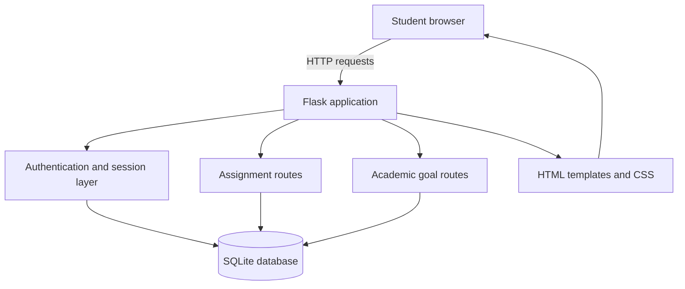

# Architecture and Design

## Architecture

## Components
- Browser presentation: HTML templates and responsive CSS.
- Flask route/controller layer: accepts form requests, validates fields, controls navigation.
- Authentication/session layer: hashes passwords with Werkzeug and uses Flask sessions.
- Data layer: SQLite with users, tasks, and goals tables; foreign keys link records to users.
- Deployment layer: Docker image, Gunicorn WSGI server, Render blueprint.

## Data model
- `users(id, name, email, password_hash, created_at)`
- `tasks(id, user_id, title, course, due_date, priority, status, created_at)`
- `goals(id, user_id, title, target_date, completed, created_at)`

Relationships: one user has many tasks and many goals. Foreign keys use `ON DELETE CASCADE`.

## Main routes
| Method | Route | Purpose |
|---|---|---|
| GET | `/` | Public landing page |
| GET/POST | `/register` | Create account |
| GET/POST | `/login` | Authenticate |
| GET | `/logout` | End session |
| GET | `/dashboard` | Display private dashboard |
| POST | `/tasks/add` | Create assignment |
| POST | `/tasks/<id>/status` | Update assignment status |
| POST | `/tasks/<id>/delete` | Delete assignment |
| POST | `/goals/add` | Create academic goal |
| POST | `/goals/<id>/toggle` | Toggle goal completion |
| POST | `/goals/<id>/delete` | Delete goal |

## Key design decisions
- A relational database supports ownership relationships and durable records.
- Parameterized SQL prevents user input from being concatenated into SQL statements.
- Every private data mutation filters by both record ID and current user ID.
- Password hashes are stored instead of plaintext passwords.
- Flask's built-in session cookie tracks authenticated users.
